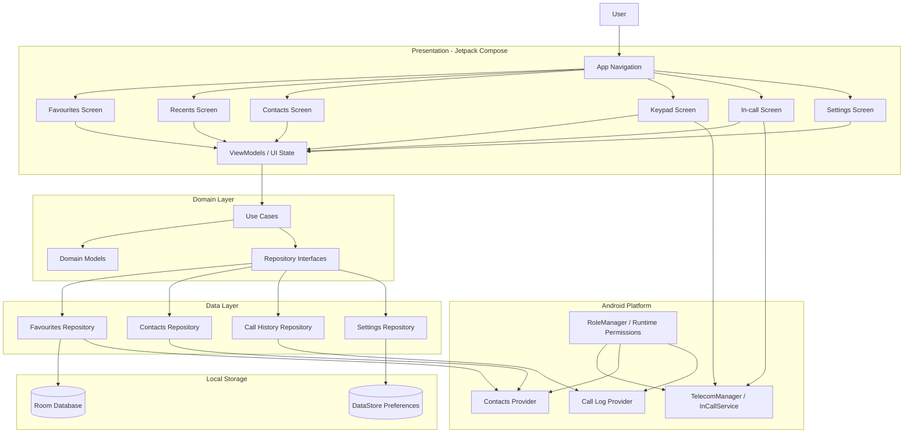
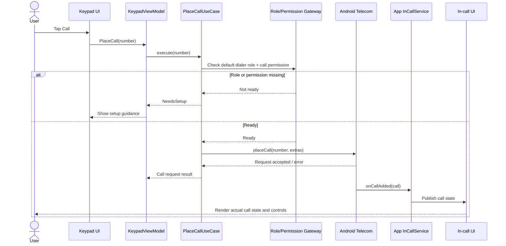

# Component Diagrams

**Status:** Proposed component boundaries; implementation is pending.

## 1. Application component diagram



## 2. Call placement sequence



## 3. Data ownership

| Data | Owner / source | App behavior |
|---|---|---|
| Contacts | Android Contacts Provider | Read on demand; do not duplicate full address book |
| Call history | Android Call Log Provider | Read and display; system owns records |
| Favourites | App Room database | Store contact lookup reference or normalized number |
| Preferences | DataStore | Store theme and user-facing preferences |
| Active call state | Android Telecom | Observe callbacks; keep transient UI state in memory |

## 4. Package layout proposal

```text
com.addulasaikiran.fluffymemory
├── app/                 # Application entry point and navigation
├── core/
│   ├── model/           # Shared domain models
│   ├── ui/              # Theme and reusable Compose components
│   └── common/          # Dispatchers, result types, utilities
├── feature/
│   ├── favourites/
│   ├── recents/
│   ├── contacts/
│   ├── keypad/
│   ├── incall/
│   └── settings/
├── domain/              # Use cases and repository contracts
├── data/
│   ├── local/           # Room and DataStore
│   └── repository/      # Repository implementations
└── platform/
    ├── telecom/
    ├── contacts/
    └── calllog/
```

This is a target package layout, not a claim that these packages already exist.
