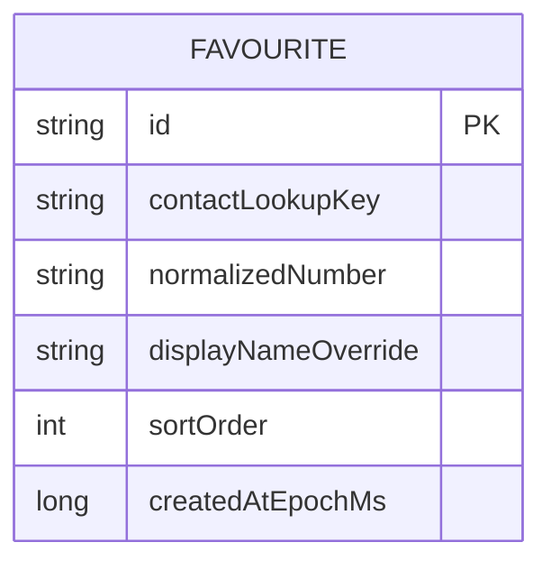

# Database Design

**Status:** Proposed schema. Room entities and migrations have not yet been implemented.

## 1. Storage principles

- Store only data the app owns.
- Android Contacts Provider is the source of truth for contacts.
- Android Call Log Provider is the source of truth for call history.
- Do not copy the full address book or call log into Room.
- Store stable provider lookup references, not assumptions that a contact ID will never change.
- Keep transient call state out of the database.

## 2. Room schema

### FavouriteEntity

| Column | Type | Rules |
|---|---|---|
| id | TEXT | Primary key; UUID |
| contactLookupKey | TEXT? | Nullable provider lookup key |
| normalizedNumber | TEXT | Required; E.164 when confidently available, otherwise normalized dial string |
| displayNameOverride | TEXT? | Optional user label |
| sortOrder | INTEGER | Required; unique ordering is enforced by repository logic |
| createdAtEpochMs | INTEGER | Required |

A favourite may point to a contact lookup key or be a manually added number. Keep the normalized number as a fallback because provider contact IDs can change.

### AppPreferenceEntity (or DataStore keys)

Prefer **DataStore** for simple key/value settings rather than a Room table.

| Key | Type | Default |
|---|---|---|
| theme_mode | STRING | system |
| haptics_enabled | BOOLEAN | true |
| number_formatting | BOOLEAN | true |

Validate values when reading and fall back safely when unknown.

## 3. Relationships



No foreign key points into Android's Contacts Provider because it is a separate system database.

## 4. Indexes and constraints

- Primary key on `FavouriteEntity.id`.
- Index `normalizedNumber` to prevent duplicate favourites and support lookup.
- Add a nullable index on `contactLookupKey` if lookup-by-contact becomes frequent.
- Enforce uniqueness of normalized numbers in repository/domain logic; a database unique index can be added if product rules disallow multiple labels for one number.
- Normalize phone numbers consistently before comparisons; preserve the user-entered dial string for dialing.

## 5. Example SQL

```sql
CREATE TABLE favourites (
  id TEXT NOT NULL PRIMARY KEY,
  contact_lookup_key TEXT,
  normalized_number TEXT NOT NULL,
  display_name_override TEXT,
  sort_order INTEGER NOT NULL,
  created_at_epoch_ms INTEGER NOT NULL
);

CREATE INDEX index_favourites_normalized_number
  ON favourites(normalized_number);

CREATE INDEX index_favourites_contact_lookup_key
  ON favourites(contact_lookup_key);
```

Room should generate the actual schema and migration metadata. The SQL above is explanatory.

## 6. Retention and migration

- Favourites remain until the user removes them or clears app data.
- Removing a favourite never deletes a contact or system call-log entry.
- If the app schema changes, use explicit Room migrations; do not destructively recreate the database in production.
- If a contact lookup key no longer resolves, display the stored number and allow the user to relink or remove the favourite.
- Do not persist active call state, DTMF digits, or permission grants.

## 7. Backup

Exclude sensitive app data from cloud backup by default in the initial privacy-focused release. If backup is later introduced, make it opt-in, document exactly what is backed up, and avoid backing up call history or contact data. Android's own system backup and device-transfer behavior must be tested against the final manifest and backup rules.
