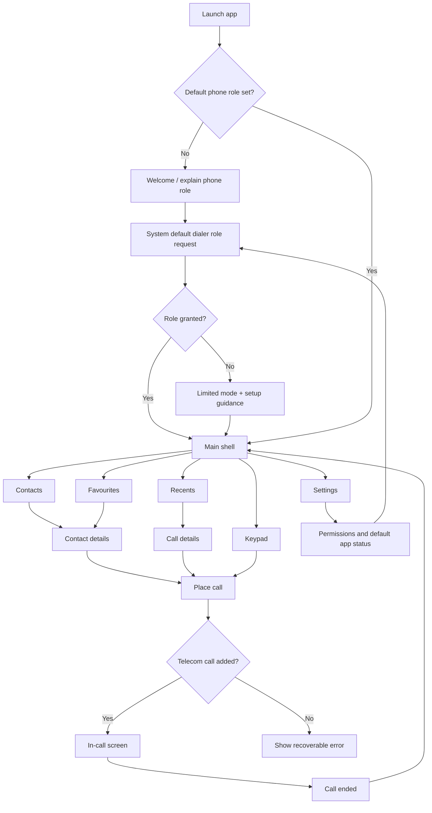

# Navigation Flow

**Status:** Proposed user-flow specification; screens are not yet implemented.

## 1. Primary navigation

The main shell has five destinations:

1. Favourites
2. Recents
3. Contacts
4. Keypad
5. Settings

The in-call screen is a separate, high-priority destination driven by Telecom call state rather than an ordinary bottom-navigation tab.

## 2. Screen responsibilities

| Screen | Main actions | Data |
|---|---|---|
| Favourites | Call, reorder, add/remove favourite | Room favourites + resolved contact data |
| Recents | Return call, view details | Android call log |
| Contacts | Search, view details, call, favourite | Contacts Provider |
| Keypad | Enter/edit number, call | In-memory keypad state + contact match |
| Settings | Theme, haptics, permissions, default app status | DataStore + Android role/permission state |
| In-call | Answer, reject, hang up, mute, speaker, DTMF | Telecom call state |

## 3. Important flows

### First launch
- Explain why the app requests the default phone role.
- Launch the official system role request.
- If declined, keep a limited browsing/keypad experience where Android permits it and clearly indicate unavailable call features.
- Never repeatedly prompt after the user declines; let them initiate setup from Settings.

### Place a call
- User taps a number from Favourites, Recents, Contacts, or Keypad.
- Validate that the dial string is non-empty and acceptable.
- Check current role and permission state.
- Ask Android Telecom to place the call.
- Wait for `InCallService` to report the call; render the actual state.
- If the request fails, retain the number and show a recoverable message.

### Incoming call
- Android Telecom delivers the call to the app's `InCallService` when the app is the active default dialer.
- Present the incoming-call UI using the call's actual state.
- Answer/reject through Telecom APIs.
- Do not use an ordinary app notification as a substitute for required Telecom call UI.

## 4. Navigation rules

- Preserve the selected main destination when opening and closing contact details.
- Keep keypad input while navigating within the main shell unless the user clears it or a call starts.
- The in-call experience takes precedence over normal navigation while a call is active.
- Handle process recreation by rebuilding active call UI from Telecom callbacks, not stale saved state.
- Back from a detail screen returns to its originating list; back from an active call must not hang up the call.
