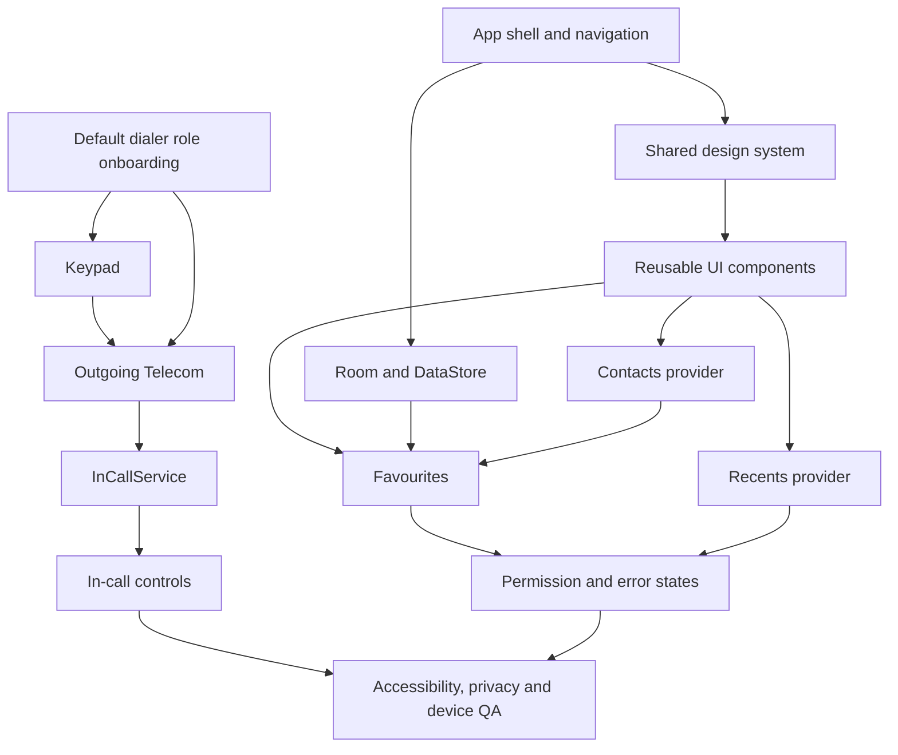

# Product Backlog and Sprint Plan

**Status:** Initial delivery plan; estimates are relative story points and must be re-estimated as implementation reveals complexity.  
**Repository:** addulasaikiran-ops/fluffy-memory  
**Build constraint:** Do not create or trigger APK builds until the product owner explicitly asks.

## Product goal

Deliver a privacy-first Android dialer with Favourites, Recents, Contacts, Keypad, Settings, and a Telecom-backed in-call experience. The product is local-first and follows the approved architecture and UI/UX specifications.

## Working agreement

- GitHub Issues are the source of truth for work items.
- Epics group related stories; story issues contain acceptance criteria and task breakdown.
- Use GitHub Projects status columns: **Backlog → Ready → In progress → In review → Done**.
- Priorities: P0 = foundation/blocker, P1 = core release, P2 = follow-up.
- Estimates use relative story points (SP); not time commitments.
- Dependencies are stated in each issue body. Do not start blocked work.
- APK build and artifact generation remain explicitly out of scope until requested.

## Epics

| Epic | Outcome | Priority |
|---|---|---|
| E1 Foundation & App Shell | Stable Compose shell, navigation, theme, shared components | P0 |
| E2 Local Data & Favourites | App-owned favourites and preferences stored locally | P1 |
| E3 Contacts & Recents | Read device contacts and call history with permission UX | P1 |
| E4 Calling & Telecom | Default dialer role, outgoing calls, incoming/in-call lifecycle | P0 |
| E5 Quality, Accessibility & Privacy | Reliable states, accessibility, privacy and device validation | P1 |

## Product backlog

| Order | Story | Epic | Priority | Estimate |
|---:|---|---|---|---:|
| 1 | Implement app shell and five-tab navigation | E1 | P0 | 3 |
| 2 | Implement shared design system and light/dark themes | E1 | P0 | 5 |
| 3 | Build reusable contact rows, avatars, buttons and search | E1 | P1 | 3 |
| 4 | Add Room and DataStore foundations | E2 | P1 | 3 |
| 5 | Add favourites list, add/remove and reorder | E2 | P1 | 5 |
| 6 | Add contacts provider access and search | E3 | P1 | 5 |
| 7 | Add recents list and call details | E3 | P1 | 5 |
| 8 | Add default phone role onboarding and status | E4 | P0 | 3 |
| 9 | Implement keypad and number validation | E4 | P1 | 3 |
| 10 | Integrate outgoing call request with Telecom | E4 | P0 | 5 |
| 11 | Implement InCallService and incoming-call UI | E4 | P0 | 8 |
| 12 | Implement in-call controls and state handling | E4 | P1 | 5 |
| 13 | Add permission-denied, empty, loading and error states | E5 | P1 | 3 |
| 14 | Accessibility and privacy hardening | E5 | P1 | 5 |
| 15 | Manual device test matrix and release readiness review | E5 | P1 | 3 |

Total indicative scope: 64 SP. This is a planning baseline, not a delivery commitment.

## Sprint plan

Assume one-week sprints for planning only. Adjust duration and capacity to the actual team.

### Sprint 1 — Foundation (13 SP)
- App shell and navigation (3)
- Design system and themes (5)
- Reusable UI components (3)
- Room/DataStore foundation (3)

**Sprint goal:** establish the navigable app foundation and reusable visual language.  
**Exit criteria:** five destinations navigate; theme switches between System/Light/Dark; shared components render; local persistence foundation is available. No APK build.

### Sprint 2 — Core local experience (13 SP)
- Favourites list and management (5)
- Contacts provider and search (5)
- Recents and call details (5)

**Sprint goal:** deliver useful local browsing and favourite management.  
**Exit criteria:** permission-aware contacts and recents screens; favourites persist across app restarts; empty and denied states are handled.

### Sprint 3 — Calling and hardening (24 SP)
- Default phone role onboarding (3)
- Keypad and number validation (3)
- Outgoing Telecom integration (5)
- InCallService and incoming UI (8)
- In-call controls (5)

**Sprint goal:** integrate real call lifecycle using Android Telecom.  
**Exit criteria:** role request uses system UI; outgoing and incoming call states are driven by Telecom; supported controls reflect actual capabilities. Validate emergency-call behavior remains system-managed.

### Sprint 4 — Quality and release readiness (11 SP)
- Permission/error/loading states (3)
- Accessibility and privacy hardening (5)
- Manual device test matrix and readiness review (3)

**Sprint goal:** verify safety, accessibility, and supported Android device behavior.  
**Exit criteria:** test matrix passes on target devices; no sensitive data in logs; permissions and role denial paths are verified. APK creation remains gated on explicit owner approval.

## Dependency graph

## Risks and sequencing notes

- Android default-dialer eligibility and call-log access are platform/policy-sensitive; validate requirements before implementation.
- InCallService is the largest technical risk; prototype it early after role onboarding and outgoing call wiring.
- Contacts and call-log data can be unavailable when permissions or role access are denied. UI must remain useful in limited mode.
- Do not duplicate Android-owned contacts or call history in Room.
- Do not add network services, analytics, recording, or cloud sync without a separate privacy review.
- Do not enable CI APK build or artifact upload until explicitly requested.

## Definition of done

- Acceptance criteria in the issue are met.
- UI supports loading, empty, denied, and error states where relevant.
- No phone numbers or contact names are written to logs.
- Accessibility labels, scalable text, and minimum touch targets are checked.
- Code is reviewed and tests are added for domain behavior.
- Dependencies and manifest permissions are justified.
- No APK build is triggered without explicit product-owner approval.
