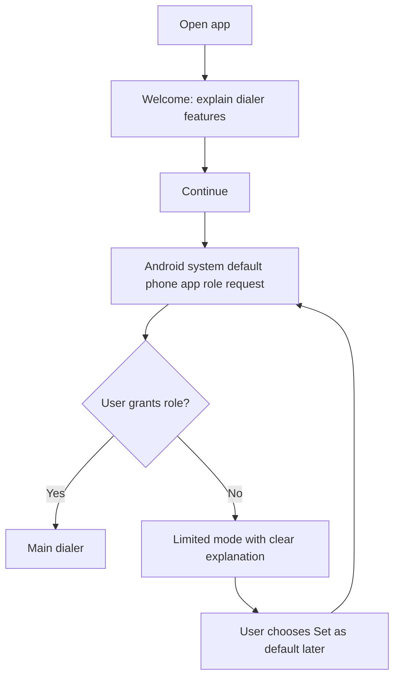
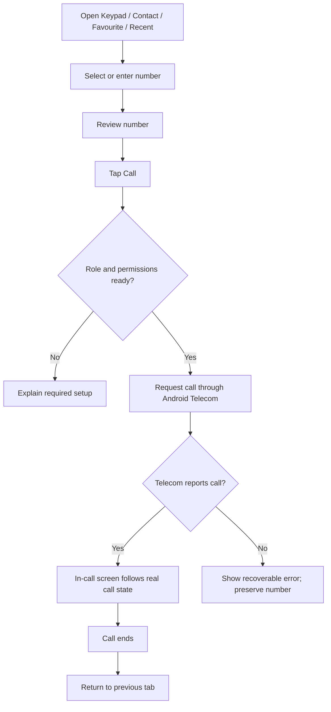
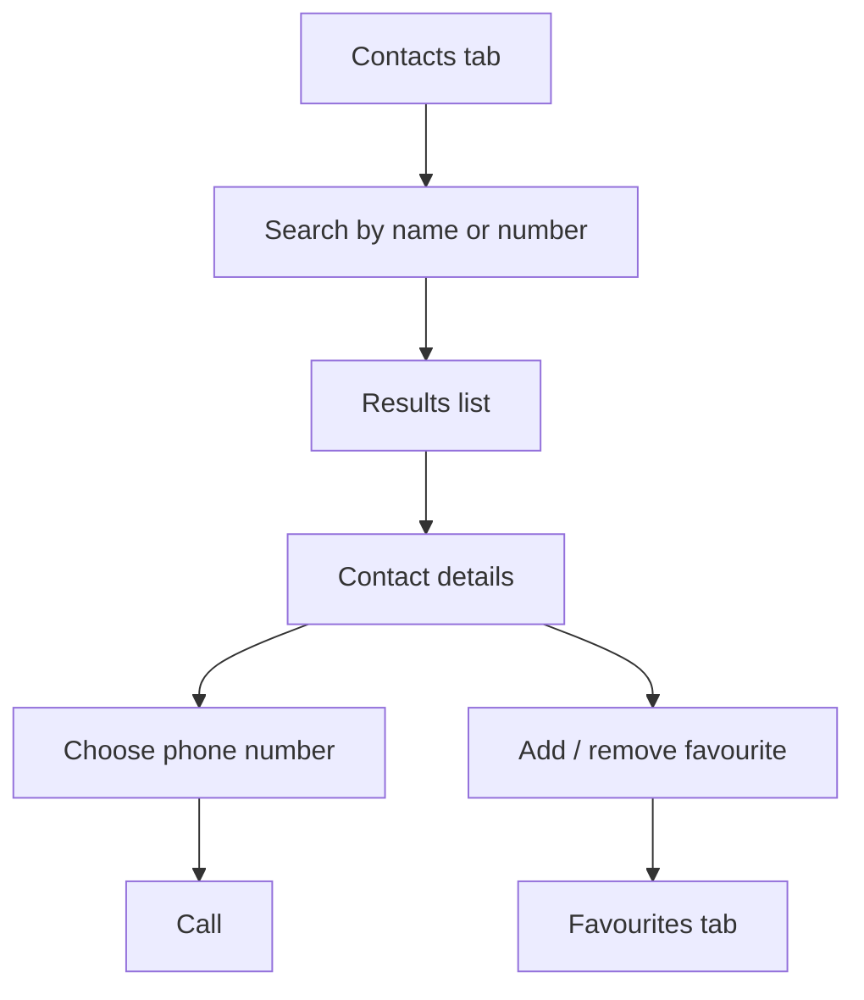
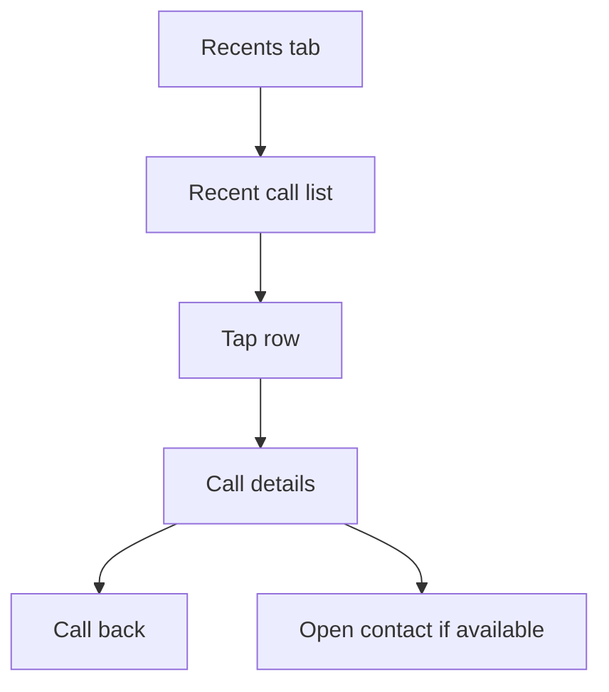

# UI/UX Design Brief

**Status:** Design proposal — not yet implemented.  
**Product:** Fluffy Memory / Android Phone Dialer  
**Design principle:** Premium, iOS-inspired visual polish with native Android behavior and accessibility.

## 1. Product experience

The dialer should feel calm, fast, personal, and trustworthy. Calling is the primary action; browsing contacts and call history should be effortless. Visual styling may take inspiration from the clarity and restraint of iOS, but platform behavior, permissions, navigation expectations, and calling integration remain Android-native.

### Experience principles

1. **Call first:** make the keypad and return-call actions easy to reach.
2. **Recognizable navigation:** use five stable destinations: Favourites, Recents, Contacts, Keypad, Settings.
3. **Quiet visual hierarchy:** generous spacing, clear labels, restrained accent color, minimal decoration.
4. **Privacy is visible:** explain why contacts, call history, and the default phone role are needed.
5. **Accessible by default:** scalable text, strong contrast, touch targets of at least 48dp, TalkBack labels, and non-color status cues.
6. **Predictable states:** design loading, empty, denied-permission, offline/unavailable-provider, and error states—not only ideal screens.

## 2. Primary user flows

### First launch and setup



### Make a call



### Find and call a contact



### Review a recent call



## 3. Screen inventory

| Screen | Purpose | Primary action |
|---|---|---|
| Welcome / role setup | Explain app and request default phone role | Set as default |
| Favourites | Quick access to important people/numbers | Call |
| Recents | Review incoming, outgoing, missed calls | Call back |
| Contacts | Search and browse device contacts | Open contact |
| Contact details | Show contact numbers and actions | Call / favourite |
| Keypad | Enter a phone number | Call |
| In-call | Manage an active or incoming call | Answer / end |
| Settings | Appearance, haptics, permissions, app role, privacy | Change setting |

## 4. Wireframe direction

These are structural wireframes, not final pixel-perfect layouts.

### Main shell

```text
┌──────────────────────────────────┐
│  9:41                       ●●●  │
│                                  │
│  Favourites                 +    │
│  Your important people          │
│                                  │
│  ┌────────────┐ ┌────────────┐  │
│  │    (AM)    │ │    (SK)    │  │
│  │  Ananya    │ │  Sandeep   │  │
│  │  Call      │ │  Call      │  │
│  └────────────┘ └────────────┘  │
│                                  │
│  ┌────────────────────────────┐ │
│  │  (R)  Recent favourite      │ │
│  │       +91 ••••• ••210       │ │
│  └────────────────────────────┘ │
│                                  │
│                                  │
│  ★          ◷       ◎      ⌗   ⚙ │
│  Favourites Recents Contacts Keypad Settings
└──────────────────────────────────┘
```

### Recents

```text
┌──────────────────────────────────┐
│  Recents                    ⌕    │
│  All calls       Missed          │
│  Today                            │
│  ↓  Ananya Sharma          10:42  │
│     Mobile • 2 min                │
│  ↗  Sandeep Kumar          09:18  │
│     Mobile                         │
│  ↓  Unknown number         08:03  │
│     Missed                         │
│                                  │
│  ★          ◷       ◎      ⌗   ⚙ │
└──────────────────────────────────┘
```

### Keypad

```text
┌──────────────────────────────────┐
│  Keypad                           │
│                                  │
│          +91 98765 43210          │
│                 ×                │
│                                  │
│       1       2       3          │
│               ABC     DEF        │
│       4       5       6          │
│       GHI     JKL     MNO        │
│       7       8       9          │
│       PQRS    TUV     WXYZ       │
│       *       0       #          │
│                                  │
│               ●                  │
│              Call                │
│                                  │
│  ★          ◷       ◎      ⌗   ⚙ │
└──────────────────────────────────┘
```

### In-call

```text
┌──────────────────────────────────┐
│                                  │
│             (AM)                 │
│          Ananya Sharma           │
│             00:42                │
│                                  │
│       Mute          Keypad       │
│       Speaker       Add call     │
│                                  │
│              [ red ]             │
│               End                │
│                                  │
└──────────────────────────────────┘
```

## 5. Interaction and motion

- Tab changes: short, subtle crossfade; avoid large sliding transitions.
- Call button: clear pressed state and haptic feedback if enabled.
- Number entry: immediate visual feedback; delete supports long-press repeat.
- Contact rows: full-row tap target, with separate accessible call action.
- In-call controls: large circular targets with clear active/inactive states.
- Avoid decorative animation that delays calling or obscures call state.

## 6. Required states

Every data-driven screen must include:
- Loading state
- Populated state
- Empty state with a useful next action
- Permission denied state
- Provider unavailable/error state
- Search with no results (where applicable)

The in-call UI must separately represent ringing, dialing, active, on hold, disconnected, and ended states as reported by Android Telecom.

## 7. Design review checklist

- [ ] One-handed keypad use on common Android phone sizes
- [ ] 48dp minimum interactive targets
- [ ] Text scales without clipping at large font settings
- [ ] TalkBack labels and logical focus order
- [ ] Contrast checked in both themes
- [ ] Missed calls are not indicated by color alone
- [ ] Role and permission explanations are clear and non-coercive
- [ ] Emergency calling is left to Android's supported system flow
